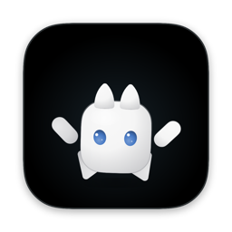
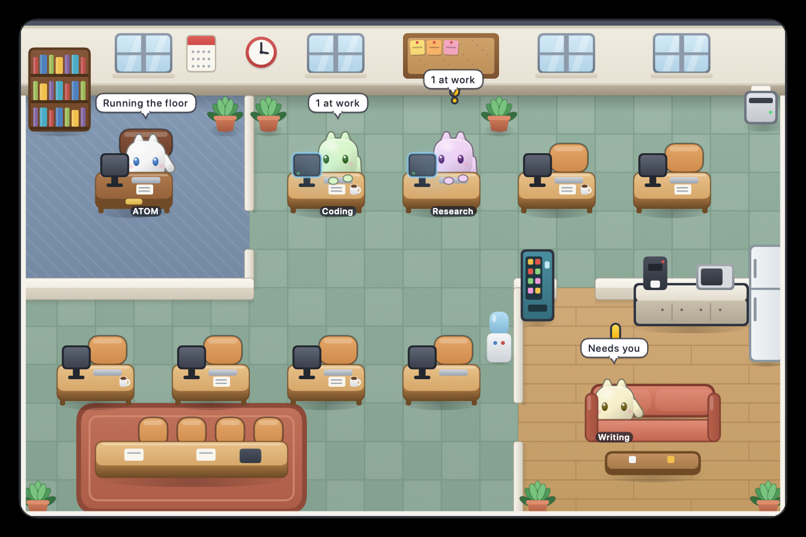
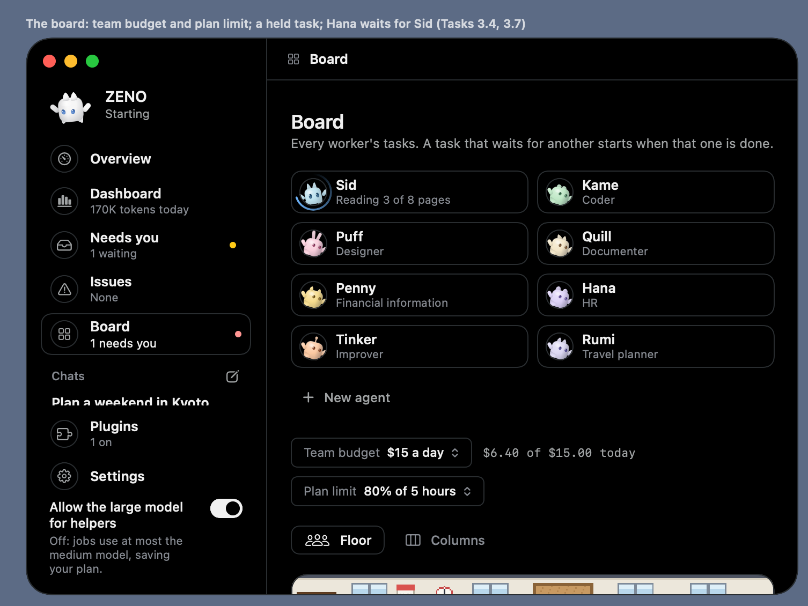
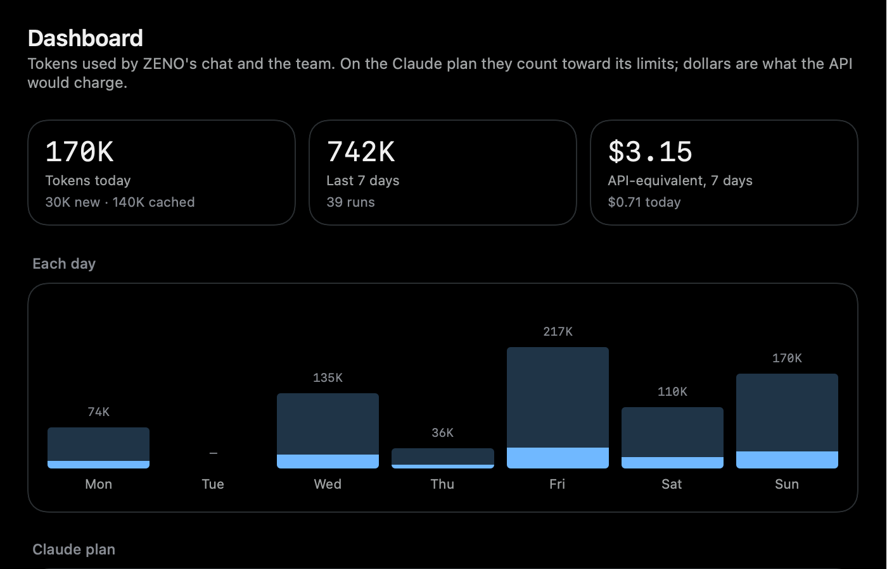
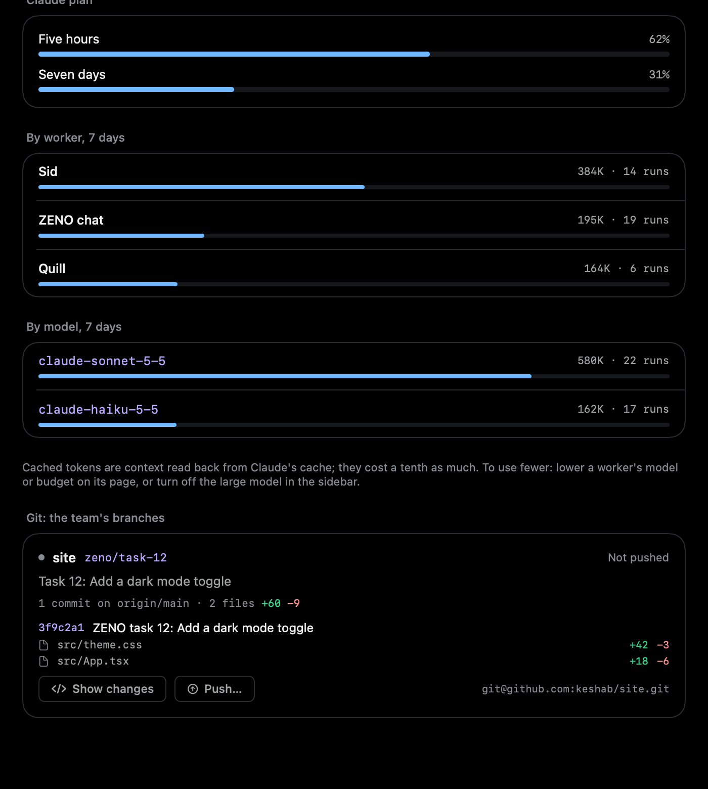

<p align="center">
  
</p>

<h1 align="center">ATOM</h1>

<p align="center"><b>Autonomous Task Oriented Machine</b><br>
Also: Autonomous Thinking and Optimization Mechanism, Adaptive Task Oriented Machine.</p>

---

## What ATOM is

ATOM is a voice and desktop assistant that lives on your Mac. A smooth 2D mascot, Pal, shows what ATOM does. An office floor shows a team of agents at work. ATOM has memory, tools, a Telegram bot, a local API and an MCP server, a skills hub, and timelines and undo for every run. You talk to ATOM. ATOM does small things itself and hands bigger ones to the team. You approve what matters. Your data stays on your Mac.

ATOM is not a chatbot. The language model is one part of it. Permissions, memory, approvals and safety checks are ordinary code. A model cannot talk its way around them.

## Screenshots

<p align="center">
  
  <br><sub>The office floor: ATOM runs the floor, working agents sit at a desk, the rest wait in the lounge.</sub>
</p>

<p align="center">
  
  <br><sub>The ATOM window: your chats in the sidebar and the team on the Board.</sub>
</p>

<p align="center">
  
  
  <br><sub>The Dashboard: tokens by day, agent and model (left); plan use and the git branches of the team (right). Sample data.</sub>
</p>

## Features

**Talk and dictate**
- Push-to-talk from any app (Control + Option). ATOM answers out loud.
- Dictation into any text field (Right ⌘ + Right ⌥). The Mac transcribes your speech.
- Chats: ATOM saves each conversation. You continue it by voice or text.
- Type "/" in the chat to open a list of commands. It shows ATOM's own commands (`/new`, `/model`, `/skills`, `/memory`, `/help`), your skills, and your Claude commands from `~/.claude/commands`. ATOM reads those files and never changes them.
- The window has a Daylight theme and a dark theme. You can drag the sidebar rows into your own order.

**Pal and the office floor**
- Pal is a smooth 2D mascot. It shows what ATOM does: listening, thinking, speaking, asking.
- The office floor shows each agent at a desk with its current step, or in the lounge when it waits.

**Agents, ATOM and sub-agents**
- Each agent has a role and a `soul.md` file. You can edit, rename and version it.
- A kit decides the tools of an agent in code: research (the web), folders (files anywhere in your home folder, under the rules below), or think (no tools).
- ATOM splits a goal, hands the parts to the right agents, and reports in one line.
- Each agent runs as a sub-agent inside the chat that handed it the task.
- Tasks wait for each other. Plans wait for your OK. Routines run on a schedule.
- Each run has an activity timeline.
- The Board has four views: Needs you, Overview, Floor and Columns. Needs you holds what waits for your answer and what failed. A badge on the Board row shows the count.
- Skills: you can open a skill's `SKILL.md` in a built-in editor. ATOM writes the file only when you click Save, and it keeps a `.bak` copy.
- MCP servers: paste a server's JSON config and ATOM fills in the form. You give each server to the agents you choose.

**Tokens and cost**
- The Dashboard shows tokens and dollars by day, agent and model. Dollars are list prices, worked out from the tokens of each call.
- ATOM answers a topic you ask about itself, in a few sentences. It hands work to an agent only when you name one, ask for sources, change files, or need many separate lookups.
- A research agent searches at most 3 times and reads at most 2 pages.
- Claude Code's own calls (a small model that reads web pages) show as "Other" rows. A web search costs $0.01 and is priced in the rows.
- Measured on 2026-10-15, with Haiku 5.5 on both sides and a fresh chat for each prompt. Costs are list prices, and Claude Code ran with a full personal setup (rules, hooks, plugins). ATOM cost $0.030 in total and Claude Code $0.098. By prompt, ATOM cost $0.0005 against $0.0097 (a simple question), $0.0015 against $0.0175 (a design question with code), $0.026 against $0.060 (a sourced web summary), and $0.0019 against $0.011 (typing text into TextEdit). Both sides gave correct answers. These are single runs on cold sessions, so treat them as rough. Details are in [DECISIONS.md](DECISIONS.md) (ADR-118).

**Memory, calendar, reminders, timers, weather**
- ATOM keeps facts you ask it to remember and picks up earlier conversations.
- ATOM reads your calendar and reminders, adds reminders, sets timers, and gives the weather.

**Tools and computer control**
- Music, notes, opening apps, and "what is this page?" for the browser in front.
- Computer control is off until you turn it on in Settings → General (or set `ATOM_COMPUTER=1`). ATOM restarts to apply the switch. Risky steps wait for your approval.
- With computer control off, ATOM says it cannot type into other apps. It does not guess.
- A browser tool for agents. A password field always asks.

**Phone: Telegram**
- Talk to ATOM, answer the Needs you list, steer tasks and read reports from your phone.
- Add `ATOM_TELEGRAM_BOT_TOKEN` and `ATOM_TELEGRAM_CHAT_ID` to `.env`. ATOM serves only that chat. Step by step: [docs/telegram.md](docs/telegram.md).

**Integrations: local API, MCP server, skills hub, Paperclip**
- Local API on `127.0.0.1` (off by default). Other tools give goals to ATOM and read results.
- An MCP server for Claude Code and Hermes. See [Use ATOM from other tools](#use-atom-from-other-tools).
- Skills hub: search and install skills from a pinned list of public repositories. You approve each install.
- Paperclip: ATOM can hand tasks to your own Paperclip. It is off until you set `ATOM_PAPERCLIP_URL`.

**Safety**
- Files (ADR-122, ADR-123): every agent works in your home folder and on external drives, with one fixed floor. It never opens `~/Library`, hidden folders, secrets, ATOM's own data, git's own files, or identity, bank, tax and medical documents. A new file is saved at once. Changing a file that exists asks you once per file. Deleting and commands that harm the system are refused. A copy of each changed file is kept for undo.
- Approvals: deleting, installing, untrusted MCP tools and computer control wait for your OK.
- Masking: secrets in the activity timeline show as `[hidden]`.
- Undo: ATOM keeps the files a run changes. You can undo them.
- No secrets: ATOM uses your signed-in Claude Code and never reads its login. Logs hold ids, states and timings, never your words.
- Agents never push code. Only you push, from the Dashboard.

Details: [SECURITY.md](SECURITY.md).

## Quick start

### Requirements

- macOS 14 or later.
- Xcode Command Line Tools: `xcode-select --install`.
- Node.js 22.18 or later and pnpm (the repository pins `pnpm@12.6.0`).
- ffmpeg and whisper.cpp: `brew install ffmpeg whisper-cpp`.
- Claude Code, signed in: `claude auth login`. ATOM runs on your own Claude plan. No API key is needed.

### Install

```sh
git clone <this repository>
cd atom
pnpm install
mkdir -p models
curl -L -o models/ggml-small.en.bin https://huggingface.co/ggerganov/whisper.cpp/resolve/main/ggml-small.en.bin
```

The Kokoro voice and the Parakeet dictation model download themselves on first use.

### Configure

```sh
cp .env.example .env
```

Set the `ATOM_*` values you need in `.env`. All of them are optional. ATOM still reads old `ZENO_*` names as a fallback.

### Build and open the app

Once per Mac, create a local signing identity so macOS keeps the permissions across rebuilds:

```sh
apps/mac/island/make-signing-identity.sh
```

Then build and open the app:

```sh
pnpm island:open    # builds apps/mac/island/build/ATOM.app and opens it
```

To run ATOM in the terminal without the app, run `pnpm start`.

### Permissions

macOS asks the first time ATOM needs each one.

- Microphone: while you hold the talk keys or dictate.
- Input Monitoring: to notice the talk and dictation keys.
- Accessibility: to type dictated text into the app in front.
- Automation: when you ask for Music, Notes or the browser tab.
- Calendar and Reminders: when you ask about your schedule or reminders.
- Notifications: when something needs you.
- Screen Recording and Accessibility for Cua Driver: only with `ATOM_COMPUTER=1`.

After a rebuild under a new bundle id (`dev.atom.island`), grant them again.

### Tests

```sh
pnpm typecheck
pnpm test          # all TypeScript tests, including a smoke test that starts a real runtime (about 30 seconds)
pnpm island:test   # the Swift tests
pnpm window:shot   # captures the real, open ATOM window to /tmp/atom-window.png (needs Screen Recording for your terminal)
pnpm test:visual   # draws every window offscreen and compares it to tests/ui-golden (build the app first: pnpm island:build)
pnpm test:live     # the live smoke test: a real Claude session and a real agent (about one minute, uses a little of your plan)
```

The smoke tests (`tests/smoke.test.ts`, `tests/smoke.live.test.ts`, helper `tests/smoke-harness.ts`) start `node apps/mac/src/main.ts --island` in a temp folder with a clean environment. They never touch your `data/`, `.env` or token. The live test saves, edits and tries to delete one file in a temp folder under `~/Documents`, and removes it. GitHub runs typecheck, `pnpm test` and the Swift tests on every push (`.github/workflows/ci.yml`), and a blocking visual job that keeps the rendered images as an artifact; the live test does not run there.

## Use ATOM from other tools

Turn on Settings → General → Local API. Then add the MCP server to Claude Code. Use the full path to this folder:

```sh
claude mcp add atom -- node /path/to/atom/apps/mac/src/mcp-serve.ts
```

The tools are `atom_give_goal`, `atom_goal_status`, `atom_chat`, `atom_list_tasks`, `atom_task_report`, `atom_needs_you` and `atom_answer_need`. The local API listens on `http://127.0.0.1:4790`. Change the port with `ATOM_API_PORT`. Each request needs the bearer token from `data/api-token`. The token can approve or reject plans and retry tasks; it cannot answer risky-action cards, skill installs or soul changes (those are answered in the ATOM window or on Telegram). Turn the API off when you do not use it. Settings → General has "Regenerate" to replace the token.

## Architecture

```text
You (voice, text, the window, Telegram, the local API)
  │
  ▼
ATOM.app (Swift): Pal, the island, the ATOM window, notifications
  │  line-delimited JSON (docs/island-protocol.md)
  ▼
ATOM runtime (Node.js, TypeScript)
  ├── Speech: Whisper (hearing), Kokoro (voice), Parakeet (dictation)
  ├── ATOM Core: requests, chats, tools, memory
  ├── Helpers: agents, souls, tasks, routines, grants (SQLite)
  ├── LLM Gateway: Claude Code, Codex with checked host tools, Gemini CLI for text
  └── Policy in code: folder checks, approvals, the sandbox
```

More: [ARCHITECTURE.md](ARCHITECTURE.md).

## Project layout

| Path | What it holds |
|---|---|
| `apps/mac/src/` | The Node.js runtime (TypeScript) |
| `apps/mac/island/` | The Swift app (`ATOM.app`) and its tests |
| `services/` | Core, helpers, LLM gateway, memory, tool engine, decision engine |
| `packages/` | Shared contracts and utilities (`@atom/*`) |
| `data/agents/` | One `soul.md` per agent |
| `docs/` | Protocol, vision, design notes and images |

Every part is described in [PROJECT_STRUCTURE.md](PROJECT_STRUCTURE.md).

## Documentation

| Document | What it covers |
|---|---|
| [TASK.md](TASK.md) | Each task as built, with its tests |
| [STATUS.md](STATUS.md) | What is built and what is next |
| [DECISIONS.md](DECISIONS.md) | Every architecture decision (ADRs) |
| [SECURITY.md](SECURITY.md) | What ATOM may and may not do |
| [ARCHITECTURE.md](ARCHITECTURE.md) | How the parts fit |
| [docs/telegram.md](docs/telegram.md) | How to set up and use ATOM from Telegram |
| [docs/mobile.md](docs/mobile.md) | How to use ATOM from a phone with Tailscale |
| [docs/island-protocol.md](docs/island-protocol.md) | The app and runtime protocol |
| [docs/VISION.md](docs/VISION.md) | The long-term vision |
| [CLAUDE.md](CLAUDE.md) | The engineering rules |

## Status

ATOM is a personal prototype. It is built and used on one Mac. The app is not packaged for other Macs. Many new features have tests but are not yet tried live. Read [STATUS.md](STATUS.md) for the current state.

## Name and history

ATOM was called ZENO until 2026-10-13. Old entries in DECISIONS.md, TASK.md and STATUS.md keep the old name.
