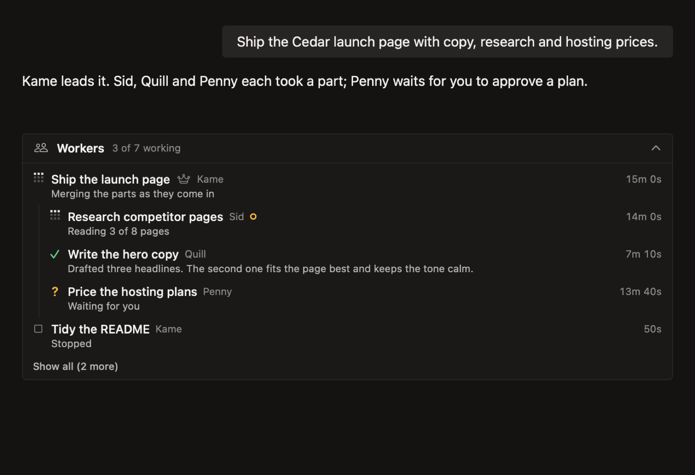
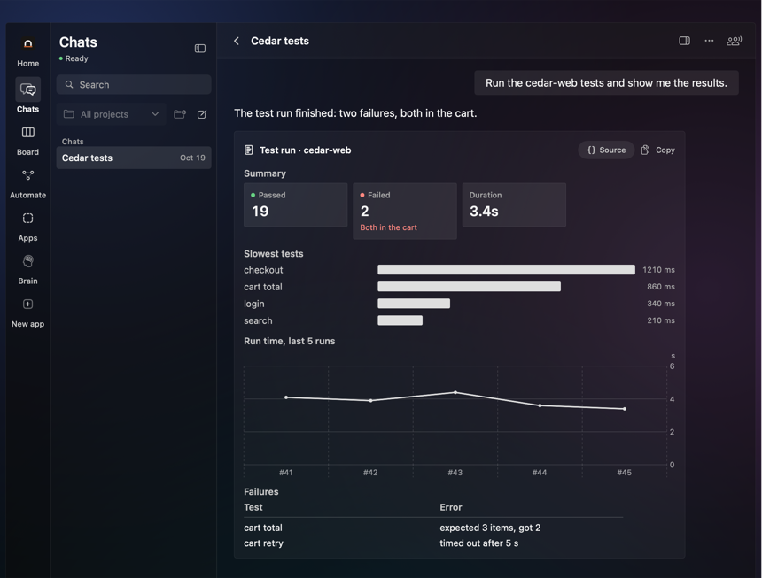
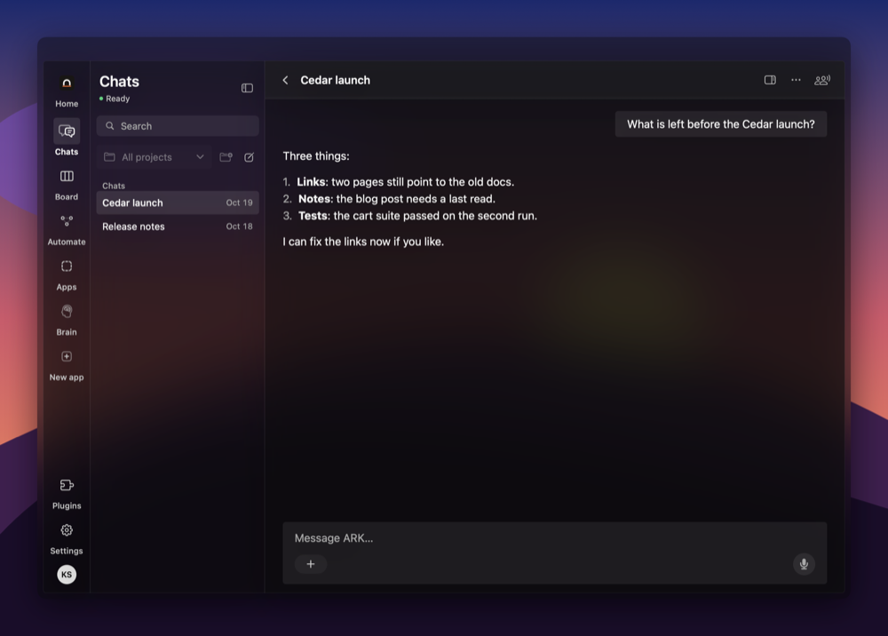

<p align="center">
  
</p>

<h1 align="center">ARK</h1>

<p align="center"><b>A voice and desktop assistant for your Mac, with a team of agents that you direct.</b></p>

<p align="center">macOS 14+ · Swift + Node.js · runs on your own Claude, Codex, Gemini, Copilot or OpenCode sign-in</p>

---

<p align="center">
  
  <br><sub><b>Chat.</b> The rail at the left, your chats, then the conversation. Pick the model, the thinking level and the access for each chat under the message field.</sub>
</p>

<p align="center">
  
  <br><sub><b>Studio.</b> The Board's Studio view: working agents sit at a desk with their current step, and idle agents wait in Recharge. The agent list is at the right.</sub>
</p>

<p align="center">
  
  
  <br><sub><b>Charts, images and drawings.</b> Left: a bar chart, a ring chart and an image. Right: a logo that ARK drew as SVG.</sub>
</p>

<p align="center">
  
  <br><sub><b>Workers card.</b> A manager splits the task. The jobs of its agents show under it, with their state and latest step.</sub>
</p>

<p align="center">
  
  
  <br><sub><b>Result cards and the translucent window.</b> Left: an <code>ark-visual</code> card. Right: the optional translucent window (sample render).</sub>
</p>

## Quick start

You need macOS 14 or later and [Claude Code](https://claude.com/claude-code). Run this in Terminal:

```sh
curl -fsSL https://raw.githubusercontent.com/Keshab-Shrestha/Atom-Your_Pal/main/scripts/install-ark.command | bash
claude auth login   # once, if Claude Code is not signed in yet
```

The installer installs what is missing (it asks first), downloads ARK to `~/ARK`, builds it and opens it. The first build takes a few minutes.

On first run, ARK asks your name. Then hold **Control + Option** and talk, or type in the window.

## What ARK is

- **A voice and desktop assistant.** Talk from any app, dictate into any text field, and chat in a native Mac window.
- **A team of agents with a chain of command.** ARK is the CEO. Managers split work for their workers. Agents call agents, and one agent can run many jobs at once.
- **Policy in code, not in the model.** Permissions, approvals, memory and agent-to-agent calls are ordinary code. The model proposes. Code decides.
- **Your own sign-ins.** ARK runs on your signed-in Claude Code, Codex, Gemini CLI, GitHub Copilot CLI or OpenCode. It needs no API key.
- **Local data.** Chats, memory and agents stay in the ARK folder on your Mac.

## How it works

```text
You: voice, text, Telegram, local API
        │
        ▼
ARK.app (Swift)          window, island, Pal, Parakeet dictation
        │  line-delimited JSON
        ▼
ARK runtime (Node.js)    chats, memory, tools, policy, approvals
        │
        ├── LLM Gateway ──▶ Claude Code · Codex · Gemini CLI · Copilot CLI · OpenCode
        └── Board ────────▶ ARK (CEO) ─▶ managers ─▶ workers (own git worktrees)
```

## Features

All features: [docs/features.md](docs/features.md).

**Chat**
- Five chat providers, with thinking level and access (Saved permissions, Ask before changes, Chat only, Full access) per chat.
- Charts, SVG drawings, images and `ark-visual` result cards with stat tiles, bars, lines and tables.
- A live work log, a diff card for file changes and a numbered questions card.
- Queue messages while ARK answers (Return or Tab). "Catch me up" summarises a chat that changed while you were away.

**Agents and the Board**
- Each agent has a role, a kit (research, folders or think) and a versioned `soul.md`.
- Managers get the work first. Agents call their reports or peers. Code checks each call.
- The Workers card shows each job as a tree. A hollow ring marks a job with no output for 8 minutes.
- The Board has three views: Flow (Needs you, Running, To do, Done), Studio and Team (an org chart on an endless board).

**Voice and computer control**
- Push-to-talk (Control + Option) and dictation (Right ⌘ + Right ⌥) from any app.
- ARK clicks and types in other apps through the Cua Driver, without moving your pointer. It is off by default.

**Work by itself**
- Automations: workflows, routines on a timer and page watches, on one page.
- Apps: ask for an app or a panel. It runs in a sandbox with no network.
- Home: what needs you, who works, token use, and up to three "ARK noticed" notes with "Fix it".

**Look**
- 9 themes, 8 typefaces, Ambient glass or Flat, and an optional translucent window.

## Safety

- ARK asks before it uses `~/Library`, hidden folders, secrets, ARK's data, or bank, tax or medical files. Full access skips this question.
- A change to an existing file and a move to the Trash ask first, except in Full access. ARK keeps a copy of each changed file for Undo.
- A git push asks first, except in Full access. ARK pushes only the task's own branch, never with force.
- Network commands, sudo, system settings and git history rewrites ask first. Full access skips this question, except after an agent reads web text.
- ARK always refuses permanent deletes, remote changes and keychain reads.
- After an agent reads web text, outside-sandbox commands, MCP calls and lasting changes ask again, also in Full access.
- Logs hold ids, states and timings, never your words. ARK never reads your provider logins.

Details: [SECURITY.md](SECURITY.md). Every decision: [DECISIONS.md](DECISIONS.md).

## Install

You build ARK on your Mac from this repository. Each option ends with `scripts/setup.sh`. This script installs the packages and makes a local signing identity, "ARK Local Signing". With this identity, macOS keeps ARK's permissions across rebuilds. Then the script builds `ARK.app` and opens it.

**Option 1: the installer file.** Download **Install-ARK.command** from the [latest release](https://github.com/Keshab-Shrestha/Atom-Your_Pal/releases/latest). In Finder, right-click it and choose **Open** (macOS blocks a double-click the first time). Answer the questions in Terminal.

**Option 2: one command.** Use the command in [Quick start](#quick-start). To use another folder, put `ARK_DIR=/path/to/folder` before `bash`.

**Option 3: Homebrew.** The tap is [Keshab-Shrestha/homebrew-ark](https://github.com/Keshab-Shrestha/homebrew-ark). `ark-install` is the same installer as Option 1.

```sh
brew install keshab-shrestha/ark/ark
ark-install
```

**Option 4: build by hand.**

```sh
git clone https://github.com/Keshab-Shrestha/Atom-Your_Pal.git ARK
cd ARK
sh scripts/setup.sh
```

To run the runtime in Terminal without the app, run `pnpm start`.

**Settings.** All `.env` settings are optional. Copy `.env.example` to `.env` in the ARK folder. For example, set `ARK_TELEGRAM_BOT_TOKEN` and `ARK_TELEGRAM_CHAT_ID` for Telegram.

**Update.** Run the installer again. Or, in the ARK folder, run `git pull` and then `sh scripts/setup.sh`.

**Uninstall.** Quit ARK and delete the ARK folder (`~/ARK`). Your chats and memory are in its `data/` folder. Copy that folder first to keep them.

### Requirements

The installer checks each required item and asks before it installs one with Homebrew.

| Item | Required | Use | Install by hand |
|---|---|---|---|
| macOS 14 or later | Yes | The app | — |
| Xcode Command Line Tools | Yes | Swift compiler, git | `xcode-select --install` |
| Homebrew | Installer only | Installs the tools below | [brew.sh](https://brew.sh) |
| Node.js 22.18 or later | Yes | ARK's runtime | `brew install node` |
| pnpm | Yes | ARK's packages | `brew install pnpm` |
| Claude Code, signed in | Yes | ARK's main model, on your Claude plan | `brew install --cask claude-code`, then `claude auth login` |
| Codex | No | Codex chats and image generation | `npm install -g @openai/codex`, then sign in once |
| Gemini CLI | No | Gemini chats | `npm install -g @google/gemini-cli` |
| GitHub Copilot CLI or OpenCode | No | Copilot or OpenCode chats | Install it and sign in. ARK finds it. |
| ffmpeg and whisper.cpp | No | The fallback for speech to text | `brew install ffmpeg whisper-cpp` |
| Cua Driver | No | Computer control | [github.com/trycua/cua](https://github.com/trycua/cua), then `cua-driver permissions grant` |

The voice (Kokoro) and dictation (Parakeet) models download the first time you use them. macOS asks for each permission the first time that ARK needs it. ARK uses Microphone, Input Monitoring, Accessibility, Automation, Calendar, Reminders and Notifications. Computer control also needs Screen Recording.

## Use ARK from other tools

Turn on Settings → General → Local API. Then add the MCP server to Claude Code, with the full path to the ARK folder:

```sh
claude mcp add ark -- node /path/to/ark/apps/mac/src/mcp-serve.ts
```

The tools are `ark_give_goal`, `ark_goal_status`, `ark_chat`, `ark_list_tasks`, `ark_task_report`, `ark_needs_you` and `ark_answer_need`.

The local API listens on `http://127.0.0.1:4790`. `ARK_API_PORT` changes the port. Each request needs the bearer token from `data/api-token`. The token can read saved memory facts, Brain note previews and shared chat history. It can approve or reject plans and retry tasks. It cannot answer risky-action cards, skill installs or soul changes. Turn the API off when you do not use it. Settings → General → "Regenerate" replaces the token.

Telegram: [docs/telegram.md](docs/telegram.md). Phone with Tailscale: [docs/mobile.md](docs/mobile.md).

## Architecture

| Part | What it does |
|---|---|
| `ARK.app` (Swift) | The window, the island, Pal, notifications, push-to-talk and dictation (Parakeet) |
| Runtime (Node.js, TypeScript) | Requests, chats, tools, memory, policy and approvals |
| Speech | Parakeet in the app, Whisper as the runtime fallback, Kokoro for the voice |
| `services/helpers` | Agents, souls, jobs, the org chart, routines and grants (SQLite) |
| LLM Gateway | Claude Code, Codex (with checked host tools), Gemini CLI, Copilot CLI and OpenCode |
| Policy | Folder checks, approvals, the sandbox and the agent-call rules, all in code |

The app and the runtime talk in line-delimited JSON ([docs/island-protocol.md](docs/island-protocol.md)). More: [ARCHITECTURE.md](ARCHITECTURE.md).

## Project layout

| Path | What it holds |
|---|---|
| `apps/mac/src/` | The Node.js runtime (TypeScript) |
| `apps/mac/island/` | The Swift app (`ARK.app`) and its tests |
| `services/` | `core`, `helpers`, `llm-gateway`, `memory`, `tool-engine`, `decision-engine` |
| `packages/` | Shared contracts and utilities (`@ark/*`) |
| `data/agents/` | One `soul.md` for each agent |
| `docs/` | Protocol, features, design notes and images |

Every part: [PROJECT_STRUCTURE.md](PROJECT_STRUCTURE.md).

## Documentation

| Document | What it covers |
|---|---|
| [docs/features.md](docs/features.md) | All features |
| [SECURITY.md](SECURITY.md) | What ARK may and may not do |
| [ARCHITECTURE.md](ARCHITECTURE.md) | How the parts fit |
| [DECISIONS.md](DECISIONS.md) | Every architecture decision (ADRs) |
| [STATUS.md](STATUS.md) and [TASK.md](TASK.md) | What is built, with its tests |
| [docs/chat-visuals.md](docs/chat-visuals.md) | The `ark-visual` card grammar |
| [docs/island-protocol.md](docs/island-protocol.md) | The app and runtime protocol |
| [docs/VISION.md](docs/VISION.md) | The long-term vision |
| [CLAUDE.md](CLAUDE.md) | The engineering rules |

## Contributing and tests

1. Fork the repository and run `sh scripts/setup.sh`.
2. Read [CLAUDE.md](CLAUDE.md): one capability for each change, smallest change first.
3. Run the checks: `pnpm typecheck && pnpm test && pnpm island:test` (or `pnpm check`).
4. Update the docs that the change touches: TASK.md, STATUS.md, DECISIONS.md, SECURITY.md.
5. Open one pull request for each capability.

```sh
pnpm typecheck
pnpm test          # all TypeScript tests, with a smoke test that starts a real runtime (about 30 seconds)
pnpm island:test   # the Swift tests
pnpm test:visual   # draws every window offscreen and compares it to tests/ui-golden (run pnpm island:build first)
pnpm test:live     # a real Claude session and a real agent (about one minute; uses a little of your plan)
```

The smoke tests start the runtime in a temporary folder with a clean environment. They never touch your `data/`, `.env` or token. GitHub runs typecheck, `pnpm test`, the Swift tests and a visual check on every push (`.github/workflows/ci.yml`). The live test does not run there.

## Status

You build ARK from source on your Mac. There is no signed, packaged app for other Macs yet. Many new features have tests but no live check yet. The install commands download the `main` branch. Some features on this page reach `main` when their pull requests merge. [STATUS.md](STATUS.md) gives the current state. The repository has no license file yet.
