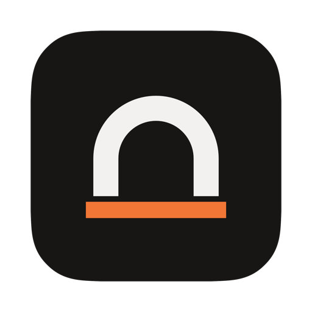
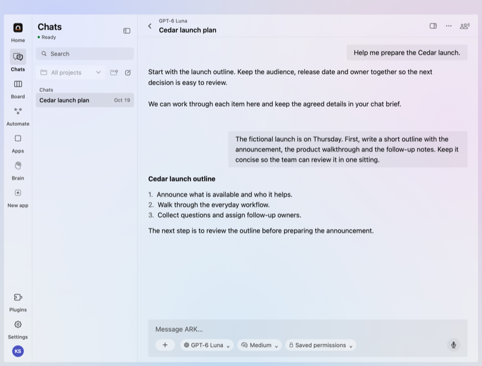
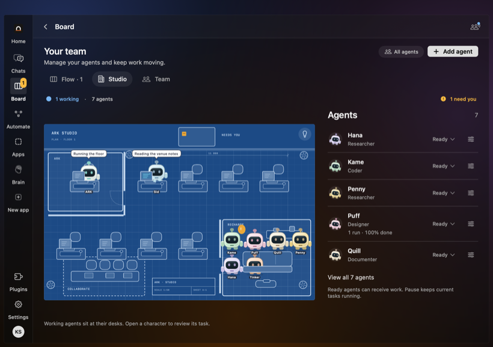
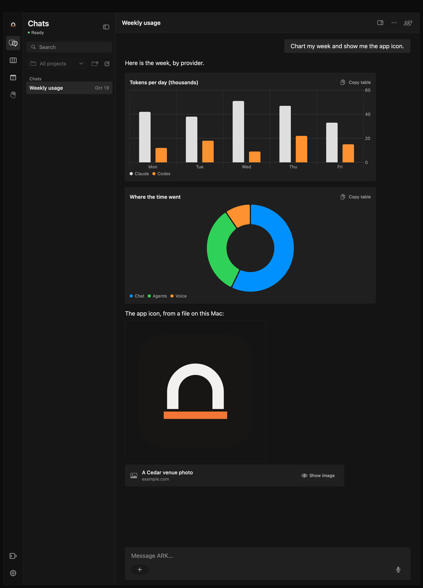
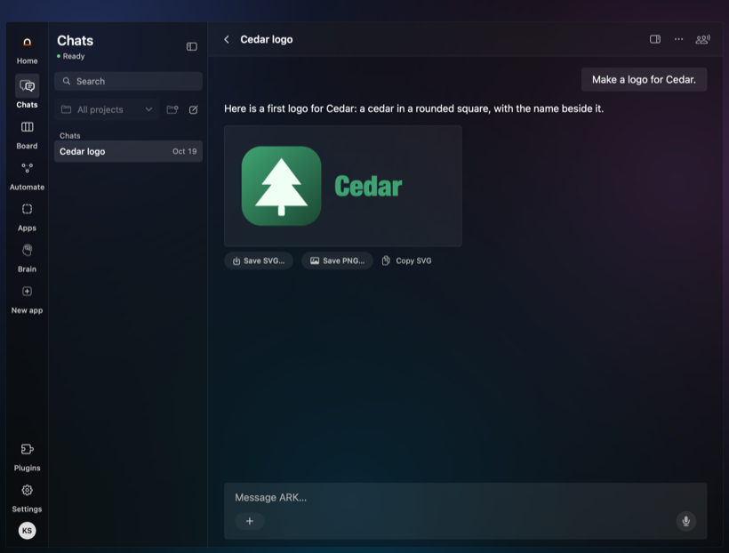

<p align="center">
  
</p>

<h1 align="center">ARK</h1>

<p align="center"><b>A voice and desktop assistant for your Mac, with a team of agents.</b></p>

---

ARK runs on your Mac. You talk or type. ARK answers, uses tools, and hands bigger work to its agents. Permissions, memory and approvals are ordinary code, not model decisions. Your data stays on your Mac.

<p align="center">
  
  <br><sub><b>Chat.</b> Your chats on the left, the conversation on the right. Pick the model, the thinking level and the access for each chat under the message field.</sub>
</p>

<p align="center">
  
  <br><sub><b>Studio.</b> The Board shows your agents as a blueprint: working agents sit at a desk with their current step, idle agents wait in Recharge. The light bulb switches between a navy and a pale print.</sub>
</p>

<p align="center">
  
  
  <br><sub><b>Charts, images and drawings.</b> Left: a reply with a bar chart, a ring chart and an image. Right: a logo that ARK drew, with Save SVG, Save PNG and Copy SVG.</sub>
</p>

## Features

### Chat
- Chats are saved. Continue any chat by voice or text.
- Models: Claude (your signed-in plan), Codex (your ChatGPT sign-in) and Gemini CLI. The model picker shows provider logos and favourites.
- Thinking level per chat: Low, Medium, High, Extra high or Max, when the model has it.
- Access per chat: Saved permissions, Ask before changes, Chat only or Full access.
- Replies use Markdown: tables, lists, code. Copy a reply as Markdown, plain text or rich text. Copy a table as Markdown, HTML, TSV or CSV.
- Charts: ask for a chart and ARK draws bars, lines or a ring. "Copy table" copies the numbers.
- Drawings: ask for a logo or icon and ARK draws it as SVG. Save SVG, Save PNG (1024 px) or Copy SVG.
- Images: an image file on your Mac shows in the reply. A web image loads only when you click "Show image".
- Image generation: Codex chats make photos and illustrations. ARK keeps each one in `data/images`.
- Select text (⇧⌘A): the whole chat as one text. Drag or ⌘A selects across messages. ⌘C keeps bold, italic, underline and tables.
- Copy whole chat, Find in chat (⌘F), Search all (⇧⌘F), Copy last reply (⇧⌘C).
- New chat (⌘N), new project (⇧⌘N).
- Type "/" for commands: ARK's own, your skills, and your Claude commands from `~/.claude/commands`.
- Attach files and paste images. Quote a reply. Edit or retry a message in a new chat. Fork a chat.
- Pin and archive chats. Each chat has a brief, its task results and its saved history.
- ARK states facts plainly and names the source when sources disagree.

### Projects
- A project is a folder or a git repository (local, Git URL or GitHub).
- Project chats get file tools, commands and an isolated git worktree for each agent task.
- Workspace pane (⌥⌘R): Files, Changes (with Undo), Git, Browser, Terminal, Run and Details.

### Voice
- Push-to-talk from any app (Control + Option). ARK answers out loud.
- Dictation into any text field (Right ⌘ + Right ⌥), on Parakeet.
- ARK can read agent reports and updates aloud, with a chime.

### Agents and the Board
- Each agent has a role, a kit and a `soul.md` (personality, how it works, rules, lessons). Edits are versioned.
- Kits: research (the web), folders (files), think (no tools). In a Full access chat every agent has every kit's tools.
- ARK answers known topics itself. It hands work to an agent only when you name one, ask for sources, change files, or need many lookups.
- ARK makes a new agent when none fits. You approve it on a card.
- Plans: ARK splits a big job into portions, one agent each.
- The same team rules on Claude and Codex.
- The Board has five views:
  - Studio: the agents at their desks, drawn as a blueprint. The light bulb switches between a navy and a pale print.
  - Needs you: questions, approvals and failed tasks.
  - Tasks: tasks by status, with labels, notes and an inspector.
  - Team: an org chart that shows who works now.
  - Activity: what the team did.
- Routines run on a schedule. Wake-ups run an agent every set time.
- Skills: ARK offers to save a good task as a skill and improves a skill when you complain. A skills hub installs skills from pinned public repositories.
- MCP servers: paste a server's JSON config. Give each server to the agents you choose.
- Each agent can have its own browser profile.
- Paperclip: hand tasks to your own Paperclip (`ARK_PAPERCLIP_URL`).

### Computer control
- ARK looks at app windows and clicks, types and scrolls through the Cua driver. Your real pointer does not move.
- A teal fingertip pointer shows where ARK acts, with a ring when it arrives.
- Off until you turn it on in Settings → Computer.

### Memory and everyday tools
- ARK remembers facts you ask it to keep and recovers earlier parts of a chat.
- Brain: notes, links and source folders that ARK can read.
- Calendar, reminders, timers, weather, notes, music, opening apps, and "what is this page?" for the browser in front.

### Dashboard
- Tokens and list-price dollars by day, agent and model. Trends for 7, 30 or 90 days.
- Plan use, cache hits, an activity heatmap and the team's git branches.

### Phone and other tools
- Telegram: talk to ARK, answer Needs you, steer tasks and read reports ([docs/telegram.md](docs/telegram.md)).
- Local API on `127.0.0.1` (off by default) and an MCP server for Claude Code and Hermes ([details](#use-ark-from-other-tools)).

### Look and settings
- 7 themes: Void, Daylight, Midnight Sapphire, Graphite & Champagne Gold, Royal Plum & Lavender, Obsidian & Electric Teal, Graphite & Ember.
- 8 typefaces: System, Helvetica Neue, Source Sans, Work Sans, Lato, Poppins, Nunito, Mulish. Four text sizes.
- Settings → Defaults: model, thinking and access for new chats, where ⌘N opens, the start page and the Dashboard range.
- Pal: a 2D mascot that shows when ARK listens, thinks, speaks or asks, and flies to point at things.
- Drag sidebar rows into your own order.

### Safety
- Files: agents work in your home folder and on external drives. `~/Library`, hidden folders, secrets, ARK's data, git's own files and identity, bank, tax and medical documents are protected.
- Changing an existing file asks once per file, except in Full access. A copy of each changed file is kept for Undo.
- Network commands, sudo, system settings and git history rewrites ask, then run outside the sandbox.
- A git push asks, then ARK pushes the task's own branch to origin, never forced.
- Always refused: permanent deletes (files go to the Trash), remote changes and keychain reads.
- After web text is read, lasting changes, MCP calls and outside-sandbox commands ask again, also in Full access.
- An approval card that gets no answer expires. The agent is told so; it is not counted as a refusal.
- Secrets in the activity timeline show as `[hidden]`. Logs hold ids, states and timings, never your words.
- ARK uses your signed-in Claude Code and Codex. It never reads their logins.

Details: [SECURITY.md](SECURITY.md). Every decision: [DECISIONS.md](DECISIONS.md).

## Quick start

ARK is built from source on each Mac (R4, [docs/release-r4.md](docs/release-r4.md)). The fast way:

```sh
git clone <this repository>
cd ark
sh scripts/setup.sh
```

The script checks the requirements below and says how to get what is missing. Then it installs the packages, makes the local signing identity, builds the app and opens it. Run it again after each `git pull`. The steps below do the same by hand.

### Requirements

- macOS 14 or later.
- Xcode Command Line Tools: `xcode-select --install`.
- Node.js 22.18 or later and pnpm (the repository pins `pnpm@12.6.0`).
- ffmpeg and whisper.cpp: `brew install ffmpeg whisper-cpp`.
- Claude Code, signed in: `claude auth login`. ARK runs on your own Claude plan. No API key is needed.

### Install

```sh
git clone <this repository>
cd ark
pnpm install
mkdir -p models
curl -L -o models/ggml-small.en.bin https://huggingface.co/ggerganov/whisper.cpp/resolve/main/ggml-small.en.bin
```

The Kokoro voice and the Parakeet dictation model download themselves on first use.

### Configure

```sh
cp .env.example .env
```

Set the `ARK_*` values you need in `.env`. All of them are optional.

### Build and open the app

Once per Mac, create a local signing identity so macOS keeps the permissions across rebuilds:

```sh
apps/mac/island/make-signing-identity.sh
```

Then build and open the app:

```sh
pnpm island:open    # builds apps/mac/island/build/ARK.app and opens it
```

To run ARK in the terminal without the app, run `pnpm start`.

### Permissions

macOS asks the first time ARK needs each one.

- Microphone: while you hold the talk keys or dictate.
- Input Monitoring: to notice the talk and dictation keys.
- Accessibility: to type dictated text into the app in front.
- Automation: when you ask for Music, Notes or the browser tab.
- Calendar and Reminders: when you ask about your schedule or reminders.
- Notifications: when something needs you.
- Screen Recording and Accessibility for Cua Driver: only with `ARK_COMPUTER=1`.

After a rebuild under a new bundle id (`dev.ark.island`), grant them again.

### Tests

```sh
pnpm typecheck
pnpm test          # all TypeScript tests, including a smoke test that starts a real runtime (about 30 seconds)
pnpm island:test   # the Swift tests
pnpm window:shot   # captures the real, open ARK window to /tmp/ark-window.png (needs Screen Recording for your terminal)
pnpm test:visual   # draws every window offscreen and compares it to tests/ui-golden (build the app first: pnpm island:build)
pnpm test:live     # the live smoke test: a real Claude session and a real agent (about one minute, uses a little of your plan)
```

The smoke tests (`tests/smoke.test.ts`, `tests/smoke.live.test.ts`, helper `tests/smoke-harness.ts`) start `node apps/mac/src/main.ts --island` in a temp folder with a clean environment. They never touch your `data/`, `.env` or token. The live test saves, edits and tries to delete one file in a temp folder under `~/Documents`, and removes it. GitHub runs typecheck, `pnpm test` and the Swift tests on every push (`.github/workflows/ci.yml`), and a blocking visual job that keeps the rendered images as an artifact; the live test does not run there.

## Use ARK from other tools

Turn on Settings → General → Local API. Then add the MCP server to Claude Code. Use the full path to this folder:

```sh
claude mcp add ark -- node /path/to/ark/apps/mac/src/mcp-serve.ts
```

The tools are `ark_give_goal`, `ark_goal_status`, `ark_chat`, `ark_list_tasks`, `ark_task_report`, `ark_needs_you` and `ark_answer_need`. The local API listens on `http://127.0.0.1:4790`. Change the port with `ARK_API_PORT`. Each request needs the bearer token from `data/api-token`. The token can approve or reject plans and retry tasks; it cannot answer risky-action cards, skill installs or soul changes (those are answered in the ARK window or on Telegram). Turn the API off when you do not use it. Settings → General has "Regenerate" to replace the token.

## Architecture

```text
You (voice, text, the window, Telegram, the local API)
  │
  ▼
ARK.app (Swift): Pal, the island, the ARK window, notifications
  │  line-delimited JSON (docs/island-protocol.md)
  ▼
ARK runtime (Node.js, TypeScript)
  ├── Speech: Whisper (hearing), Kokoro (voice), Parakeet (dictation)
  ├── ARK Core: requests, chats, tools, memory
  ├── Helpers: agents, souls, tasks, routines, grants (SQLite)
  ├── LLM Gateway: Claude Code, Codex with checked host tools, Gemini CLI for text
  └── Policy in code: folder checks, approvals, the sandbox
```

More: [ARCHITECTURE.md](ARCHITECTURE.md). Current and proposed upgrades: [combined roadmap](docs/upgrade-roadmap.md).

## Project layout

| Path | What it holds |
|---|---|
| `apps/mac/src/` | The Node.js runtime (TypeScript) |
| `apps/mac/island/` | The Swift app (`ARK.app`) and its tests |
| `services/` | Core, helpers, LLM gateway, memory, tool engine, decision engine |
| `packages/` | Shared contracts and utilities (`@ark/*`) |
| `data/agents/` | One `soul.md` per agent |
| `docs/` | Protocol, vision, design notes and images |

Every part is described in [PROJECT_STRUCTURE.md](PROJECT_STRUCTURE.md).

## Documentation

| Document | What it covers |
|---|---|
| [TASK.md](TASK.md) | Each task as built, with its tests |
| [STATUS.md](STATUS.md) | What is built and what is next |
| [DECISIONS.md](DECISIONS.md) | Every architecture decision (ADRs) |
| [SECURITY.md](SECURITY.md) | What ARK may and may not do |
| [ARCHITECTURE.md](ARCHITECTURE.md) | How the parts fit |
| [docs/telegram.md](docs/telegram.md) | How to set up and use ARK from Telegram |
| [docs/mobile.md](docs/mobile.md) | How to use ARK from a phone with Tailscale |
| [docs/island-protocol.md](docs/island-protocol.md) | The app and runtime protocol |
| [docs/VISION.md](docs/VISION.md) | The long-term vision |
| [CLAUDE.md](CLAUDE.md) | The engineering rules |

## Status

ARK is a personal prototype. It is built and used on one Mac. The app is not packaged for other Macs. Many new features have tests but are not yet tried live. Read [STATUS.md](STATUS.md) for the current state.
