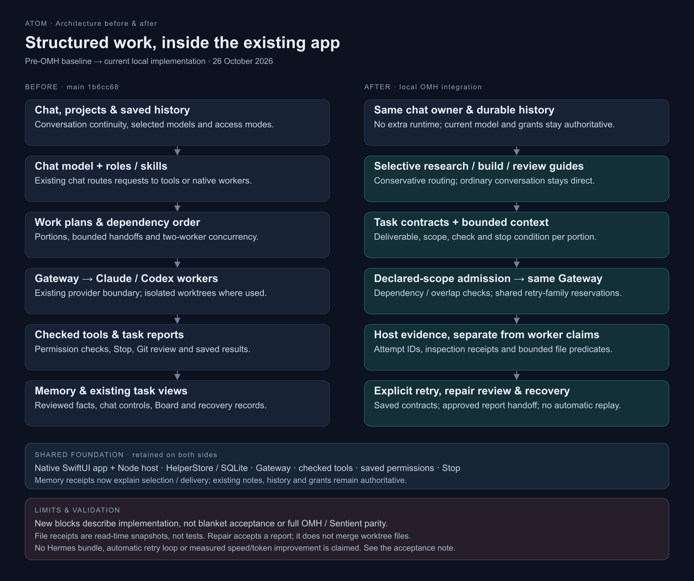

# OMH architecture within ATOM

26 October 2026. Keshab selected **ATOM-native integration** of OMH's architectural patterns, extending the existing app rather than bundling Hermes. The baseline is main `1b6cc685`; the local implementation is on `codex/oh-my-hermes-inquiry`. [Pinned source inquiry](oh-my-hermes-feature-inquiry.md).

[Editable SVG](assets/atom-architecture-before-after.svg) · [Actual acceptance results and remaining checks](omh-acceptance-2026-10-26.md)

## Ownership and authority

Existing chat owns conversation history, HelperStore owns plans/jobs in SQLite, Gateway owns provider access and checked tools own actions. Permissions, Stop, selected models and explicit Git handoff remain authoritative. There is no second daemon, autonomous repair loop or new permission source. A subsequent user-authorized [ATOM-owned skill catalog](omh-skill-library.md) adds 151 pinned OMH guidance entries without importing its runtime. A workflow contract describes expected work; it cannot approve an action or prove success.

Ordinary conversation remains direct. Eligible current requests can receive a small research/build/review guide, with explicit skills taking precedence. Workflow selection supplies guidance; it does not itself dispatch a worker or change providers.

## Implemented capabilities

| Capability | Current implementation | Practical boundary |
| --- | --- | --- |
| Task contracts | Versioned deliverable, scope, verify and stopWhen fields in existing plan JSON; validated again before admission. | Natural-language criteria are not mechanically certified. Legacy plans may omit contracts. |
| Context budgets | Protected instructions/continuity/contracts plus bounded optional background and prerequisite details; count-only receipts. | Limits cover composed payloads, not the entire provider session or exact token count. |
| Declared-write scheduling | Canonical project/path binding, dependency-aware overlap refusal, compatible two-slot admission and shared reservations. Retry family file work shares a conservative planning scope. | Declarations do not sandbox actual writes or merge predecessor worktrees. |
| Task evidence | Host attempts, Codex read-only inspection receipts and Claude/Codex bounded file predicates. | Exists/contains/SHA observations are historical snapshots, not test passes or whole-task verification. |
| Memory receipts | Saved-fact selection, source-group budget decisions and per-request outcome in the existing chat memory popover. | No claim of model use or complete visibility into retained provider context. |
| Workflow routing | Three conservative built-in guides; project/web/worker capability checks; lazy lookup for unmatched chat. | No automatic dispatch or broad semantic router. |
| Plan history | Chat-scoped paged history and explicit single-plan/portion inspection. | Inspection never selects an older plan for execution or refreshes its evidence. |
| Explicit retry | Durable deduplicated intent plus a prebound one-portion plan; preserves contract, guide, checks, scopes and bounded prerequisite reports. | Revalidates source lineage/project before admission; no fallback to a replacement or uncontracted plan. Old receipts are not copied. |
| Reviewed repair | Immutable digest-bound acceptance of a completed retry report into an original failed/stopped portion. Fresh native approval is required even in Full access. | Original task stays failed/stopped. Accepting a report never transfers files, commits, merges or starts dependents. Missing/stale handoffs block rather than guess. |
| Recovery summary | Read-only projection of reported, interrupted, unconfirmed, stopped, blocked and queued-retry records; existing Board/task links. | Never replays work, rewrites history or grants access. File effects may already exist. |
| Chat Stop | Foreground cancellation also stops current-chat native workers after their parent reply ends, using all active jobs rather than the recent display list. | Another chat's jobs are retained. Provider cancellation is requested through the existing host gate. |

## Contracts and file predicates

A contract accepts only `schema`, `deliverable`, `scope`, `verify` and `stopWhen`. The canonical schema is `atom.workflow-task/v1`; every text field is nonempty and the generated metadata envelope is 6,000 UTF-8 bytes. These are generated-context limits, not user composer limits. Unknown fields/versions and incomplete contracts refuse admission.

Eligible folder portions can separately declare up to six literal file predicates (`exists`, `contains`, `sha256`). ATOM pins the execution workspace before dispatch and checks policy, cancellation and workspace identity around readback. Symlinks, hard links, incomplete/binary/control text and unavailable workspaces fail closed. The complete UTF-8 reader is bounded to 32 KiB/1,000 lines. No shell, model judge, arbitrary expression or test runner is used by this collector. A worker report remains unchanged and distinct from host evidence.

For Claude isolated workspaces, actual SDK hook `cwd` must corroborate the captured workspace before a positive receipt is possible. A missing/mismatched observation stays unavailable. Real-provider acceptance of this path is still pending; the isolated collector check does not establish SDK behavior.

## Retry, repair and recovery

Retries keep only the requested failed/stopped portion; prerequisite reports remain historical context. They never rerun prerequisites automatically or inherit old verification. The original declaration/project binding is retained and rechecked rather than silently rebound.

`plan_repair` first inspects the completed retry and returns an exact review digest. Accept requires a fresh native approval and transaction-time revalidation. Declared file checks must have matched on the retry's own attempt. With no declared checks, acceptance is explicitly report-only and does not certify correctness. A dependent already started cannot have its earlier context rewritten retroactively.

The plan may use an accepted report as its effective prerequisite result while preserving the original job link, failed outcome and both task histories. Native rows expose Retry report and Original. Missing records or altered digests make a handoff unavailable and block dependencies. Recovery summaries are explanations, never resume commands.

## Source map

- `services/helpers/src/workflow-{contract,routing,retry,repair,recovery}.ts`: versioned workflow metadata, report handoff and read-only recovery projection.
- `services/helpers/src/{context-budget,write-scopes,file-checks,task-evidence}.ts`: bounded context, planning admission and host provenance.
- `services/helpers/src/{work-plan,plans,store-plans,store}.ts`: existing durable plan/job lifecycle and chat-scoped history.
- `apps/mac/src/{native-plan,native-safety,native-board,codex-tools,task-file-verification}.ts`: shared admission, provider completion and checked readback.
- `services/memory/src/recall-receipts.ts` and `apps/mac/src/chat-controls.ts`: bounded memory provenance in the existing UI.
- Native `WorkPlans.swift`, `Protocol.swift`, `PlanViews.swift` and task result views: additive decoding and collapsed evidence/recovery presentation.

Detailed early-slice notes retain their historical checkpoint results: [context](omh-context-budget.md), [evidence](omh-task-evidence.md), [write declarations](omh-write-scopes.md), [memory receipts](omh-memory-receipts.md). The [26 October acceptance note](omh-acceptance-2026-10-26.md) supersedes their earlier “no build/restart/live checks” status for the bounded paths actually exercised.

## Validation and next work

The cumulative TypeScript check, signed native release build, signature/diff checks, six isolated host integration checks and three focused cancellation regressions pass. Actual Claude chat/continuity, contract dispatch, historical inspection, normal restart, honest result UI and stopped-plan recovery guidance were exercised. The acceptance note records IDs and limits.

The [27 October Claude acceptance](omh-claude-file-acceptance-2026-10-27.md) passed actual isolated edit/readback, protected-path refusal, deliberate mismatch and Stop before collection; the stopped-summary count discrepancy it found is now [corrected and live-verified](stopped-task-summaries.md). Next acceptance remains Codex file readback, native retry/repair approval, collection/workspace races, abrupt interruption, concurrent admission, continuing exact-file grants and memory-receipt replay cases. Controlled context/cache/latency measurements remain separate. No full parity, speed improvement or token saving is claimed. Existing release-critical defects still take priority, and cursor acceptance remains deferred.
